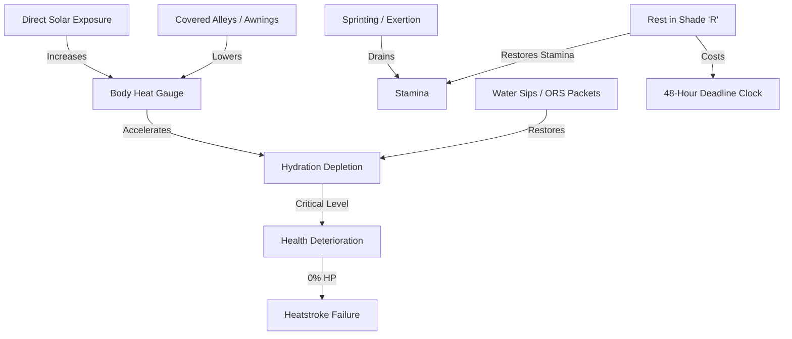
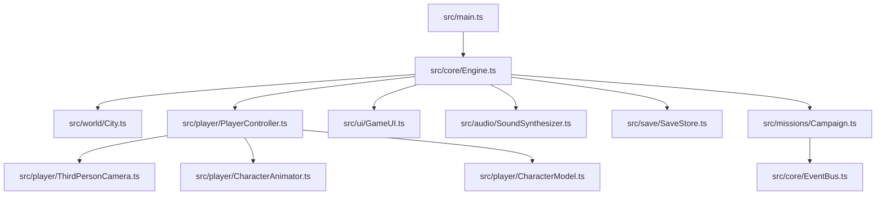

# 🌡️ HEATLINE: 48 Hours to Survive

<div align="center">

[](https://www.typescriptlang.org/)
[](https://threejs.org/)
[](https://vitejs.dev/)
[](https://developer.mozilla.org/en-US/docs/Web/API/WebGL_API)
[](LICENSE)
[](tests/campaign.test.mjs)

**A 3D third-person atmospheric survival-narrative game built for the modern browser.**  
*48 hours. Scorching urban heatwave. Every route, rest, and sip of water matters.*

[Features](#-key-features) • [Gameplay & Controls](#-controls--gameplay) • [Survival Mechanics](#-survival-systems) • [Architecture](#-architecture) • [Getting Started](#-getting-started) • [Testing](#-validation--testing)

</div>

---

## 🌆 Overview

**HEATLINE: 48 Hours to Survive** drops players into the suffocating climate emergency of fictional **Vardhan City**. As temperatures soar past fatal thresholds, municipal power grids collapse and water supplies run dry. You have exactly **48 hours** on the campaign clock to navigate interconnected city districts, assist struggling citizens, solve critical infrastructure planning puzzles, manage scarce supplies, and secure an escape route.

Built from scratch using **Three.js**, **TypeScript**, and **Vite**, HEATLINE requires **zero external assets, no external API keys, and no remote CDNs**. All geometry, human character rigs, procedural textures, ambient city crowds, and soundscapes are synthesized directly on the client.

```
       ┌───────────────────────────────────────────────────────────┐
       │             VARDHAN CITY - HEAT CRISIS DAY 1              │
       │                                                           │
       │   [48:00:00] TIME REMAINING       TEMP: 47.8°C / CRITICAL │
       │   HYDRATION:  [████████░░] 80%    SHADE: OUT IN SUNLIGHT  │
       │   STAMINA:    [██████░░░░] 60%    HEALTH: [██████████]100%│
       │                                                           │
       │   OBJECTIVE: Restore North Sector Grid Substation         │
       └───────────────────────────────────────────────────────────┘
```

---

## ✨ Key Features

- **☀️ Dynamic Heat & Shade System**: Real-time solar exposure simulation. Direct sunlight drains stamina and spikes dehydration; hugging alleyway awnings and shadowed routes preserves vitals.
- **⏱️ Consequential 48-Hour Clock**: Authentic mission progression where physical travel, resting, crafting, and dialog decisions deplete realistic chunks of your 48-hour deadline.
- **🎭 Branching Narrative & 5 Endings**: 8 fully scripted chapters with 32 multi-stage objectives, moral dilemmas, trust metrics with NPCs (e.g. Raghav, Meera), and 5 distinct ending classifications.
- **🧩 Interactive Planning Boards**: Solve tactical power routing, water filtration, and transit bypass mini-puzzles to unlock district shortcuts and civic resources.
- **🎒 Scavenging & 18-Slot Inventory**: Tactical resource conservation. Scavenge abandoned markets, maintenance depots, and relief stations for ORS packets, filters, and coolant packs.
- **🔊 Synthesized Web Audio**: Procedurally generated urban wind, electric hums, crowd murmurs, and footsteps created with the native Web Audio API without bulky audio files.
- **💾 Offline Persistence & Checkpoints**: Resilient IndexedDB storage engine with automatic state snapshots, localStorage fallbacks, and quick checkpoint recovery.

---

## 🎮 Controls & Gameplay

<div align="center">

| Action | Primary Control | Secondary Control |
| :--- | :--- | :--- |
| **Move (Walk / Run)** | <kbd>W</kbd> <kbd>A</kbd> <kbd>S</kbd> <kbd>D</kbd> | <kbd>▲</kbd> <kbd>◄</kbd> <kbd>▼</kbd> <kbd>►</kbd> |
| **Sprint** | Hold <kbd>Shift</kbd> | — |
| **Crouch** | <kbd>C</kbd> *(Toggle)* | Reduces heat gain in low cover |
| **Jump** | <kbd>Space</kbd> | Traversal across obstacles |
| **Look / Camera Orbit** | Left Mouse Drag | Mouse Orbit / Double-Click for Pointer Lock |
| **Interact / Scavenge** | <kbd>E</kbd> | Within 3m of objective or supply cache |
| **Inventory & Crafting** | <kbd>I</kbd> | Open 18-slot supply management |
| **Mission Journal** | <kbd>J</kbd> | View active objectives & relationship status |
| **Rest (in Covered Lane)** | <kbd>R</kbd> | Recovers stamina at the cost of campaign time |
| **Hand Lamp** | <kbd>F</kbd> | Night and blackout navigation |
| **Pause / Settings** | <kbd>Esc</kbd> | Releases pointer & opens settings menu |

</div>

---

## ⚙️ Survival Systems



### The Survival Triad
1. **Thermoregulation**: Staying in direct sunlight builds heat buildup. Seek shadows under concrete viaducts, tarpaulin canopies, and narrow alleys.
2. **Hydration Economy**: Drinking water replenishes hydration immediately. Conserving bottles or sharing them with companions shifts social relationships and unlocks future assistance.
3. **Time vs. Vitality**: Resting restores energy and reduces heat stress, but burns precious hours from your 48-hour escape deadline.

---

## 🏛️ Architecture

The codebase follows a modular, decoupled engine design written strictly in TypeScript:



### Directory Breakdown

```text
Heatline/
├── public/                 # Static data & schema definitions
│   └── data/               # Missions, items, and dialogue tables
├── src/
│   ├── audio/              # Synthesized procedural Web Audio engine
│   │   └── SoundSynthesizer.ts
│   ├── core/               # Main application loop, input, & event bus
│   │   ├── Engine.ts
│   │   ├── EventBus.ts
│   │   └── InputManager.ts
│   ├── missions/           # Campaign state machine & 32 objectives
│   │   └── Campaign.ts
│   ├── player/             # Character controller, kinematics & 3rd-person cam
│   │   ├── CharacterAnimator.ts
│   │   ├── CharacterModel.ts
│   │   ├── PlayerController.ts
│   │   └── ThirdPersonCamera.ts
│   ├── save/               # IndexedDB asynchronous state persistence
│   │   └── SaveStore.ts
│   ├── ui/                 # Cinematic HUD, dialogue overlay, journal & style
│   │   ├── GameUI.ts
│   │   ├── HUD.ts
│   │   └── style.css
│   ├── world/              # City generation, lighting, props & collision
│   │   ├── City.ts
│   │   └── TestEnvironment.ts
│   └── main.ts             # Application entrypoint
├── tests/                  # Decision-path & campaign unit validation
│   └── campaign.test.mjs
├── index.html              # Clean viewport shell
├── vite.config.ts          # Vite build configuration
└── tsconfig.json           # Strict TypeScript configuration
```

---

## 📖 Campaign Progression

The campaign spans eight intense narrative phases throughout Vardhan City:

| Chapter | Phase Title | Timeframe | Key Objective |
| :---: | :--- | :---: | :--- |
| **01** | *The Sudden Surge* | Hours 00 - 06 | Evacuate apartment, establish contact, find first water ration |
| **02** | *Dry Market Run* | Hours 06 - 12 | Scavenge market square, aid Raghav, secure medical supplies |
| **03** | *Gridlock Crossroads* | Hours 12 - 18 | Bypass civil blockade, navigate unpowered metro line |
| **04** | *Substation Blackout* | Hours 18 - 24 | Complete Power Grid Routing puzzle to restore district pumps |
| **05** | *The Boiling Night* | Hours 24 - 30 | Low-visibility night navigation, maintain lamp reserves |
| **06** | *Shelter Crisis* | Hours 30 - 36 | Water filtration puzzle, manage companion heatstroke risks |
| **07** | *The Industrial Corridor* | Hours 36 - 42 | High-ambient hazard zone, sprint between coolant mist stations |
| **08** | *Evacuation Perimeter* | Hours 42 - 48 | Reaching transit terminal; evaluate 1 of 5 ending outcomes |

---

## 🚀 Getting Started

### Prerequisites

- **Node.js** (v18.0.0 or higher recommended)
- **npm** (v9.0.0 or higher)

### Installation

1. **Clone the repository**:
   ```bash
   git clone https://github.com/mohammadfarwez23/Heatline.git
   cd Heatline
   ```

2. **Install project dependencies**:
   ```bash
   npm install
   ```

3. **Start the local development server**:
   ```bash
   npm run dev
   ```

4. **Launch the game**:
   Navigate to the local URL displayed in your terminal (typically `http://localhost:5173`).

### Production Build

To create an optimized, tree-shaken static production bundle:

```bash
npm run build
npm run preview
```

Serve the generated `dist/` directory through any static HTTP server (e.g. Nginx, Vercel, Netlify, GitHub Pages).

---

## 🧪 Validation & Testing

The project includes an automated decision-tree test suite that exhaustively verifies game logic:

```bash
npm test
```

- **1,056 Decision Paths Tested**: Exhaustive graph traversal verifying that no player decision branches lead to deadlocks or unresolvable objectives.
- **All 5 Ending Categories Verified**: Validates preconditions for all survival and humanitarian endings.
- **Inventory & Capacity Constraints**: Asserts strict 18-slot limits and consumable balance.
- **State Serialization Checks**: Tests corrupt, partial, and version-mismatched save recoveries in IndexedDB.

---

## 🛠️ Tech Stack & Design Decisions

- **Three.js (r170)**: High-performance 3D scene graph, static batching, procedural geometry generation, shadow cascades, and lighting.
- **Vanilla CSS (Glassmorphism)**: Sleek, high-contrast dark theme HUD with responsive flex/grid layouts and micro-animations.
- **Zero Asset Bloat**: Completely procedural meshes and sounds mean near-instant initial page loads (< 2MB bundle size).
- **TypeScript (Strict Mode)**: Type safety across state updates, event bus listeners, inventory transactions, and save serialization.

---

## 📄 License

This project is licensed under the [MIT License](LICENSE).

---

<div align="center">
<sub>Engineered with precision for real-time web performance. Vardhan City awaits.</sub>
</div>
